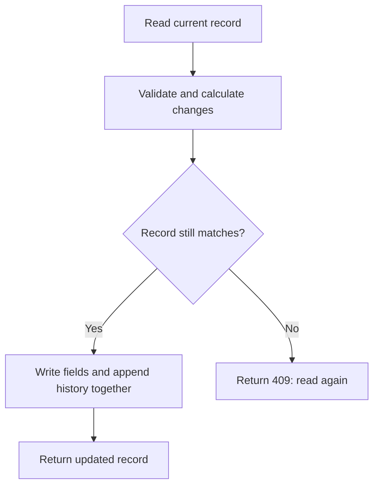

# How the code works

Start with [START_HERE](START_HERE.md) for the purpose of the project and [WALKTHROUGH](WALKTHROUGH.md) to run it. This guide connects the behaviour you see to the code that produces it.

## Every included file

| File | Why it exists |
|---|---|
| `app/main.py` | The complete Python API: validation, time rules, database setup, queries, routes and serving the built dashboard |
| `app/__init__.py` | Marks `app` as a Python package so `app.main` can be imported |
| `requirements.txt` | Pins the libraries needed to run the application |
| `requirements-dev.txt` | Includes runtime requirements and adds the test tools |
| `pytest.ini` | Tells pytest where tests live and declares the integration/scale markers |
| `tests/__init__.py` | Lets test files share small fixture helpers |
| `tests/conftest.py` | Creates isolated test databases and supplies the HTTP test client |
| `tests/test_rules.py` | Checks time boundaries, validation and decimal rounding directly |
| `tests/test_api.py` | Checks HTTP behaviour, storage, conflicts, corrections and concurrent requests |
| `tests/test_analytics.py` | Uses deliberately awkward records to check reports against expected results |
| `tests/test_scale.py` | Generates 100,000 records, checks startup and query plans, and records measurements |
| `tests/test_server.py` | Starts a separate Uvicorn process and tries a complete workflow over real HTTP |
| `tests/test_workspace.py` | Verifies that the dashboard and its assets load, and that missing database setup still returns 503 |
| `.github/workflows/tests.yml` | Runs frontend checks plus MongoDB 6/Python 3.11 and MongoDB 7/Python 3.12 API tests |
| `.gitignore` | Keeps local environments, credentials, logs and generated test output out of Git |
| `vercel.json` | A 30-second FastAPI function limit; includes the compiled dashboard assets |
| `package.json` | Frontend dependencies and the dev, test and build commands |
| `package-lock.json` | Locks the exact dependency tree so another machine can reproduce the build |
| `vite.config.js` | Builds the dashboard into `app/static/`; forwards development API requests to FastAPI |
| `index.html` | The frontend's HTML entry point and page metadata |
| `public/favicon.svg` | The small Attend mark shown in the browser tab |
| `src/main.jsx` | Starts React and loads the stylesheet |
| `src/App.jsx` | Navigation and the overview, attendance, people, reports and help screens |
| `src/components.jsx` | Shared buttons, tables, chart, dialog, loading and error displays |
| `src/forms.jsx` | Employee, punch and correction forms, plus audit-history display |
| `src/styles.css` | Typography, colours, spacing, responsive layouts and accessible focus states |
| `src/lib/api.js` | Same-origin HTTP requests, pagination, cancellation and useful error messages |
| `src/lib/format.js` | IST conversion, labels, safe CSV cells and correction payloads |
| `src/lib/format.test.js` | Tests time boundaries, omitted correction fields and CSV formula protection |
| `src/App.test.jsx` | DOM-based tests for connection errors and important form workflows |
| `app/static/index.html` and `app/static/assets/*` | Generated production frontend; rebuild instead of editing by hand |
| `README.md` | The quick entry point, commands and links to deeper explanations |
| `REVIEW.md` | Concrete defects in the starter and the fixes made |
| `DECISIONS.md` | Short answers to the five required design questions |
| `docs/START_HERE.md` | Explains the product without assuming programming knowledge |
| `docs/WALKTHROUGH.md` | Installation, exact example requests and troubleshooting |
| `docs/CODE_GUIDE.md` | This file: how the implementation fits together |
| `docs/VERIFICATION.md` | Test coverage, measured evidence and remaining limitations |
| `docs/DEPLOYMENT.md` | Hosting steps and checks still required before sharing a live demo |
| `docs/FRONTEND.md` | A plain-English dashboard walkthrough and frontend development instructions |
| `docs/THIRD_PARTY.md` | Licences for bundled React, icons and the locally served font |
| `docs/evidence/scale-evidence.json` | A saved local measurement from the 100,000-record test |
| `docs/evidence/server-evidence.json` | A saved measurement from the actual server-process test |
| `docs/evidence/test-summary.json` | A compact summary of the recorded pytest run |

`test-results/` is generated when tests run. It is intentionally ignored; the selected evidence files above are the saved results included for review. The original kit and its sample data are not copied into this repository.

## Libraries, in plain language

| Library | Job |
|---|---|
| FastAPI | Matches URLs to Python functions and handles requests and responses |
| Uvicorn | Runs the web server that listens on port 8000 |
| Pydantic | Checks request fields before the route runs |
| PyMongo | Connects to MongoDB, writes documents and runs aggregation pipelines |
| python-dotenv | Optionally reads local configuration without overriding real environment values |
| pytest | Runs automated tests and reports failures |
| HTTPX | Sends HTTP requests in tests |

`bson` comes with PyMongo; it is not a separately installed library. Dates, decimals, environment access and logging use Python's standard library. There is no LLM, external AI service or API key in this application. AI coding assistance was used to develop it, as disclosed in the README.

## Read `app/main.py` in this order

The single Python file is deliberate: the assignment requires the API application code there. Numbered comments divide it into five sections. Related logic stays in small functions. React code lives separately in `src/` and adds no alternative implementation of the attendance rules.

### 1. Configuration and database lifecycle

`load_dotenv(override=False)` preserves configuration supplied by the host. `UTC` and `IST` make timezone choices explicit. The `PRESENT` tuple names the three statuses that count as attendance.

`lifespan` runs when the server starts and stops. It creates one MongoDB client with a connection pool, checks the connection and creates the indexes. It closes the client at shutdown. It never loads sample records or deletes existing records.

`database()` gives routes the configured database, or returns a 503 error if it is not ready. `health()` pings MongoDB; it can retry index creation after a temporary startup failure. Driver failures are converted to a plain 503 response without exposing a connection string.

Routes use ordinary `def` functions. FastAPI runs these in its thread pool, which fits the synchronous PyMongo driver. An `async def` route would not make a blocking database call non-blocking.

### 2. Input validation

`InputModel` ignores unknown fields. This prevents a caller from setting calculated fields such as `late_minutes` or replacing the audit history.

| Model or helper | What it checks |
|---|---|
| `valid_date`, `DateText` | Exact YYYY-MM-DD shape and a real calendar date |
| `valid_month`, `MonthText` | Exact YYYY-MM shape and a valid month/year |
| `EpochMillis` | An actual integer in the allowed millisecond range; no coercion from strings, floats or booleans |
| `ShiftTime` | A two-digit hour and minute in a valid 24-hour time |
| `EmployeeIn` | Employee-code shape, text lengths, email pattern, joining date and unequal shift boundaries |
| `PunchOutIn`, `PunchInIn` | Employee code and an optional instant; punch-in additionally restricts presence status |
| `RegularizeIn` | Optional changed fields plus a required reason and manager label |
| `Page`, `PageSize`, `RankLimit` | The allowed query-parameter ranges |

Omission and `null` mean different things. Omitting `punched_at` means “now.” Explicitly sending `null` is invalid. For a correction, omitting a field means “keep it”; sending `null` is invalid there too. `model_fields_set` tells the correction function which fields were actually supplied.

### 3. Time rules and response conversion

`instant()` turns epoch milliseconds into an aware UTC datetime and discards fractional seconds. `utc()` also handles legacy naive datetimes as UTC. `now_utc()` returns the current whole second.

`attendance_date()` converts to IST. For a night shift, an arrival strictly before the shift-end clock time belongs to the previous attendance date. `shift_bounds()` builds that day's start and end, moving the end to the next calendar day when needed.

`derived_values()` is the shared calculator for punch-in, punch-out and corrections:

| Calculation | Why its order matters |
|---|---|
| Late minutes | Compare elapsed seconds to 600 first; only then floor to minutes |
| Work hours | Divide seconds by 3600 using Decimal, then round half-up to two places |
| Half day | Compare the rounded hours to 4.50, not the unrounded duration |
| Overtime | Floor minutes after shift end, then apply the 30-minute minimum |
| Non-presence status | Return null hours, zero late/overtime and false half-day |

`api_value()` walks response values, including nested history. BSON datetimes become integer milliseconds; internal `_id` fields are removed. `record_response()` also supplies the documented defaults for older records missing fields such as history or half-day.

### 4. Database queries and reports

An **aggregation pipeline** is a sequence of steps MongoDB performs on the data. `$match` filters, `$lookup` joins another collection, `$group` combines records, and `$project` chooses output fields. These operations run in MongoDB. Python constructs the query and returns the result; it does not fetch every attendance row and calculate reports in a loop.

| Builder | What happens in MongoDB |
|---|---|
| `monthly_pipeline` | Select one employee's month, total stored metrics, calculate working weekdays from joining date, then calculate attendance percentage |
| `department_pipeline` | Start with eligible employees, look up each person's month, then group by department |
| `leaderboard_pipeline` | Total late minutes, join known employees, apply department filtering, rank, keep the requested ranks and sort ties by code |
| `trend_pipeline` | Generate each date in the request, look up daily headcount and attendance, calculate rates, then calculate a seven-row moving average |

`stats_group()` defines shared totals. `presence_weight()` turns a full presence into 1 and a half-day presence into 0.5. `weekday()` applies the Monday–Friday rule. `working_days_expression()` counts eligible weekdays inside MongoDB. Python only calculates the requested calendar boundaries.

`rounded()` implements decimal half-up rounding for nonnegative report values. MongoDB's `$round` uses ties-to-even, so using it directly would give the wrong result for some halfway values. Hours and percentages have two decimal places; rates have four. JSON may display `8.0` rather than `8.00`; both are the same numeric value.

Important choices:

- **No-log employees:** the department report begins with employees, so an empty attendance lookup does not remove a person from headcount.
- **Average hours:** add completed presence-record hours and divide by the number of such records. Averaging each employee's average would weight people incorrectly.
- **Ranking:** `$rank` gives 1, 2, 2, 4. The limit filters rank values afterward, so the response can contain more rows than the numeric limit.
- **Missing days:** the trend first creates its calendar. An empty weekday with positive headcount has rate zero; weekends and zero-headcount days have rate null.
- **Moving average:** use the current row and six previous rows within this request. Null rates are ignored, and the first rows naturally have shorter windows.
- **Stored metrics:** reports read stored hours, late minutes, overtime and half-day values. They do not derive them again from punch timestamps.

### 5. HTTP routes

The decorators such as `@app.post(...)` connect a URL and method to the function below them. Routes validate the request, read necessary records, call the appropriate helper, write if needed, and return contract fields.

`employee_or_404()` centralizes missing-employee handling. `attendance_query()` shares filters, date-range checks and index selection between the attendance list and its explain route. `aggregate()` runs a built pipeline with the specified index hint.

`explain_endpoint()` rebuilds the real endpoint's main query with the same builder, filters, sorting and pagination, then calls MongoDB explain with `executionStats`. The resulting document is returned under `explain`; BSON-specific values use Extended JSON. The plan is not invented or replaced by a success flag.

## Why concurrent writes are safe

For employee creation and punch-in, a unique index is the final guarantee. If two requests attempt the same identity, MongoDB accepts one insert; the other gets a duplicate-key error, returned as HTTP 409.

Punch-out selects the latest punch-in at or before the supplied time. If that record is already closed, it returns 409 rather than silently closing an older record.

Corrections and punch-out use **compare-and-set** through `unchanged_filter()`: update the record only if the fields and history length still match the version just read. This catches another correction, another punch-out, and even a correction that changed a value and later changed it back.

The correction uses one MongoDB document update with `$set` and `$push`. MongoDB applies both together. The API never edits or removes an existing history entry. A multi-document transaction is unnecessary for this single-document operation.

## Which index serves which job?

| Collection | Indexed fields in order | Purpose |
|---|---|---|
| employees | `emp_code` unique | Identity, sorted lists, employee joins |
| employees | `department`, `emp_code` | Department-filtered employee lists and trend calendar anchor |
| employees | `joined_on`, `department` | All-department headcount eligibility |
| employees | `department`, `joined_on` | One-department eligibility and daily headcount |
| attendance_logs | `emp_code`, `date` descending, unique | One record per day, employee/month lookup |
| attendance_logs | `date` descending, `emp_code` | Ordered lists, date scans and daily attendance lookup |
| attendance_logs | `status`, `date` descending, `emp_code` | Status-filtered ordered lists |
| attendance_logs | `emp_code`, `punch_in` descending | Latest eligible punch-in |

An index speeds reads and makes writes/storage slightly more expensive. These indexes support specific queries; adding an index to every field would not automatically improve the service.

## A useful interview reading order

Trace one employee through `create_employee`, `punch_in`, `derived_values`, `punch_out` and `regularize_attendance`. Then read `unchanged_filter` and the concurrency tests. Finally read the four pipeline builders beside the hand-calculated examples in `test_analytics.py`.

Before presenting the project, practise explaining why 09:40:01 is late, why a tied leaderboard can return extra people, and why a department with no logs still has headcount. Try a small change in a copy: change a grace threshold, add the corresponding boundary test, and check which existing tests fail. Understanding that cause and effect is more useful than memorizing this guide.
